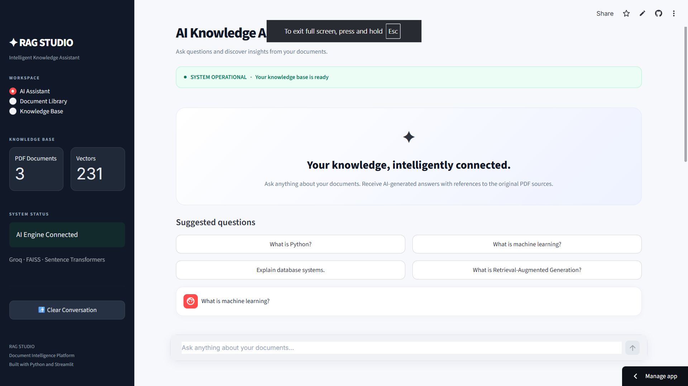
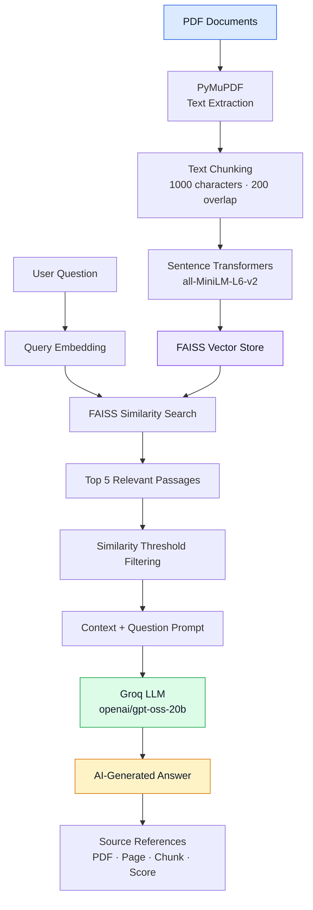

# AskMyDocs – AI-Powered PDF Question Answering System

AskMyDocs is an AI-powered document question-answering application built using **Retrieval-Augmented Generation (RAG)**.

Upload PDF documents, ask questions in natural language, retrieve relevant information using semantic search, and generate context-aware answers using a Large Language Model (LLM).

<p align="center">

**[🚀 Try AskMyDocs Live](https://askmydocs-diyexx8jehp2jf88hfg7hf.streamlit.app/)**

</p>

---

## 🌐 Live Demo

**Application:** [AskMyDocs – Live Application](https://askmydocs-diyexx8jehp2jf88hfg7hf.streamlit.app/)

The application is deployed using Streamlit Community Cloud.

## 📸 Application Preview



---

## ✨ Features

### 📄 Document Management
- Upload multiple PDF documents.
- Extract text from PDFs using PyMuPDF.
- Validate uploaded PDF files.
- Prevent duplicate document uploads.
- View and manage documents through the Document Library.
- Delete documents and rebuild the knowledge base.

### 🧠 Intelligent Retrieval
- Split documents into overlapping text chunks.
- Generate semantic embeddings using Sentence Transformers.
- Use `all-MiniLM-L6-v2` for document and query embeddings.
- Store and search document vectors using FAISS.
- Retrieve the top 5 relevant passages using similarity search.
- Filter retrieved results using a similarity score threshold.

### 🤖 AI-Powered Question Answering
- Ask natural-language questions about uploaded PDFs.
- Generate context-aware answers using Groq.
- Ground answers in retrieved document passages.
- Display source references with PDF filename, page number, chunk number, and similarity score.
- Adjust answer length and detail based on the question.
- Avoid generating answers from unsupported document information.

### 💻 Interactive Dashboard
- Streamlit-based user interface.
- AI Assistant for document question answering.
- Document Library for PDF management.
- Knowledge Base dashboard showing document and vector counts.
- Suggested questions for quick interaction.
- Conversation history during the active session.

---

## 🛠️ Technology Stack

| Component | Technology |
|---|---|
| Programming Language | Python |
| Web Framework | Streamlit |
| PDF Processing | PyMuPDF |
| Embedding Model | all-MiniLM-L6-v2 |
| Embedding Library | Sentence Transformers |
| Vector Database | FAISS |
| LLM Provider | Groq |
| LLM Model | openai/gpt-oss-20b |
| Environment Management | python-dotenv |

---

## 🏗️ RAG Architecture

AskMyDocs follows a Retrieval-Augmented Generation workflow consisting of document ingestion, semantic retrieval, and AI-powered answer generation.

### Architecture Diagram



### 🔄 Workflow

**1. Document Ingestion**
- Load PDF documents from the document directory.
- Extract page-level text using PyMuPDF.
- Divide extracted text into overlapping chunks.
- Generate semantic embeddings for each chunk.
- Store embeddings and document metadata in FAISS.

**2. Query Processing**
- Accept a natural-language question.
- Convert the question into an embedding.
- Search FAISS for the top 5 relevant passages.
- Filter retrieved passages using a similarity score threshold.

**3. Answer Generation**
- Combine retrieved passages with the user's question.
- Send the context-grounded prompt to the Groq API.
- Generate an answer using the configured language model.
- Display the answer along with source references.

**4. Source References**

Each retrieved source includes:
- Original PDF filename
- Page number
- Chunk number
- Similarity score

---

## 📂 Project Structure

```text
AskMyDocs/
│
├── data/
│   └── documents/
│       ├── Python Programming.pdf
│       ├── machine_learning.pdf
│       └── rag_systems.pdf
│
├── screenshots/
│   └── askmydocs-home.png
│
├── src/
│   ├── chunking/
│   │   ├── __init__.py
│   │   └── text_splitter.py
│   │
│   ├── embeddings/
│   │   ├── __init__.py
│   │   └── embedder.py
│   │
│   ├── generation/
│   │   ├── __init__.py
│   │   └── llm.py
│   │
│   ├── ingestion/
│   │   ├── __init__.py
│   │   ├── ingestion_pipeline.py
│   │   └── pdf_loader.py
│   │
│   ├── rag/
│   │   ├── __init__.py
│   │   └── pipeline.py
│   │
│   └── retrieval/
│       ├── __init__.py
│       └── vector_store.py
│
├── .streamlit/
├── app.py
├── main.py
├── rebuild_index.py
├── check_models.py
├── requirements.txt
├── .env.example
├── .gitignore
└── README.md
```

---

## ⚙️ Installation and Setup

### 1. Clone the repository

```bash
git clone https://github.com/Vinodkumar80744/AskMyDocs.git
cd AskMyDocs
```

### 2. Create a virtual environment

```bash
python -m venv venv
```

Activate on Windows:

```powershell
venv\Scripts\activate
```

### 3. Install dependencies

```bash
pip install -r requirements.txt
```

### 4. Configure the Groq API key

Create a `.env` file in the project root:

```env
GROQ_API_KEY=your_groq_api_key_here
```

Get your API key from the [Groq Console](https://console.groq.com/keys).

**Important:** Never upload your `.env` file or expose your API key publicly.

### 5. Add PDF documents

Place your PDF files inside:

```text
data/documents/
```

### 6. Run the application

```bash
streamlit run app.py
```

Open the local URL displayed in your terminal.

---

## 💻 CLI Usage

Run the command-line version:

```bash
python main.py
```

## 🔄 Rebuilding the Vector Index

After adding or replacing PDF files outside the application, rebuild the vector index:

```bash
python rebuild_index.py
```

---

## ☁️ Deployment

AskMyDocs is deployed using **Streamlit Community Cloud**.

Deployment configuration:

- **GitHub Repository:** [Vinodkumar80744/AskMyDocs](https://github.com/Vinodkumar80744/AskMyDocs)
- **Branch:** `main`
- **Entry Point:** `app.py`
- **API Configuration:** Streamlit Secrets

**Live Application:** [Launch AskMyDocs](https://askmydocs-diyexx8jehp2jf88hfg7hf.streamlit.app/)

---

## 🚀 Future Improvements

- Improve source citations with more detailed document references.
- Add persistent cloud storage for uploaded documents.
- Implement conversation memory across sessions.
- Support additional document formats.
- Explore retrieval reranking to improve search relevance.
- Add advanced document analytics.

---

## 👨‍💻 Author

**Nathi Vinod Kumar**

Built with Python, Streamlit, FAISS, Sentence Transformers, and Groq.

---

If you find this project useful, consider giving the repository a ⭐ star!

**GitHub Repository:** [AskMyDocs](https://github.com/Vinodkumar80744/AskMyDocs)

**Live Demo:** [Try AskMyDocs](https://askmydocs-diyexx8jehp2jf88hfg7hf.streamlit.app/)
